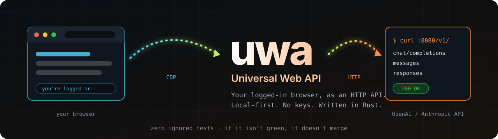

# uwa — Universal Web API

Point any OpenAI-compatible client (Cursor, Continue, the `openai` Python
SDK, `curl`) at the web UIs you're already logged into — ChatGPT, Claude,
Gemini, DeepSeek and a dozen more — and get back standard
`/v1/chat/completions` responses.

UWA is a **translation bridge**: it drives a real Chromium tab, extracts the
answer, and returns it in OpenAI or Anthropic shape. It never executes
tools itself — tool calls are returned to your client, which runs them
however it wants and sends the results back.

## Quick start

```bash
git clone https://github.com/sdlab1/uwa.git && cd uwa
./start.sh
```

That's it. The script checks dependencies, builds the daemon and the UI,
launches Chromium with the debug port on a dedicated profile, starts uwa,
and opens the dashboard at **http://127.0.0.1:8080**.

- **Log in** to your providers (ChatGPT, Claude, …) inside the Chromium
  window that just opened — one-time, kept across restarts.
- **Set the API key** in the dashboard's top-right (matches
  `[server].api_key` in `uwa.toml`; the example ships with `change-me`).
- Point your client at **`http://127.0.0.1:8080/v1`**.

To stop everything: `./start.sh --stop`.

## Flags

```
./start.sh              # default: build if needed, launch, open browser
./start.sh --stop       # stop uwa + Chromium this script started
./start.sh --no-browser # don't open the dashboard automatically
./start.sh --no-chromium # reuse an external browser (UWA_CHROMIUM_WS=…)
./start.sh --rebuild    # force a cargo rebuild
./start.sh --port 9090  # override the server port
./start.sh -h           # full help
```

## What you get

| Endpoint | Shape |
|---|---|
| `POST /v1/chat/completions` | OpenAI Chat Completions, streaming and non-streaming |
| `POST /v1/messages`         | Anthropic Messages, streaming and non-streaming |
| `POST /v1/messages/count_tokens` | Anthropic token estimate |
| `POST /v1/responses`        | OpenAI Responses (for Codex CLI) |
| `GET  /v1/models`           | model aliases from `uwa.toml` |
| `GET  /v1/provider/status`  | per-provider selectors, capabilities, backend |

The dashboard (`http://127.0.0.1:8080`) has a **Playground** with live
token-by-token streaming and TTFT, **History** with a full per-request
waterfall, **Sessions**, **Config** (with an in-browser selector tester),
**Logs** (live tail), and a **Debug** page for bottleneck analysis.

## Docs

- [Configuration](docs/CONFIG.md) — `uwa.toml` fields, providers, presets, workflows.
- [API](docs/API.md) — request/response shapes, examples, error codes.
- [Streaming](docs/STREAMING.md) — how real streaming and TTFT work.
- [Troubleshooting](docs/TROUBLESHOOTING.md) — common failures and fixes.

## Requirements

- **Rust** 1.75+ — [rustup.rs](https://rustup.rs)
- **Node.js** 20+ — [nodejs.org](https://nodejs.org)
- **Chromium / Google Chrome** — any recent version
- macOS, Linux, WSL. Native Windows is untested (PRs welcome).

## License

MIT.
